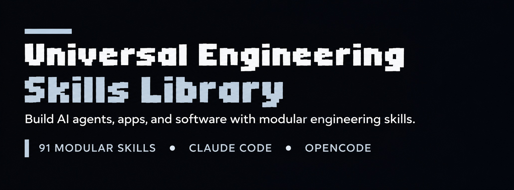
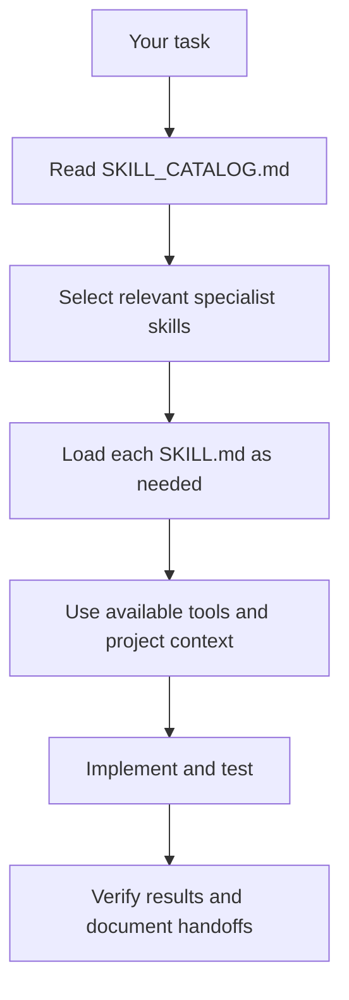
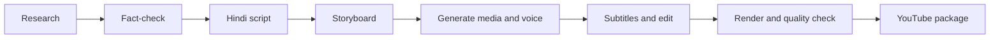

[](.claude/skills/)
[](https://docs.anthropic.com/en/docs/claude-code/skills)
[](https://opencode.ai/docs/skills/)
[](SKILL_CATALOG.md)

[Explore the Skill Catalog](SKILL_CATALOG.md) · [Installation Guide](#-installation) · [Agent Guide](AGENT_GUIDE.md) · [বাংলা নির্দেশিকা](README_BN.md)

---

## 🟠 About the Library

Universal Engineering Skills is a collection of **91 individually scoped agent skills** designed to support Claude Code and OpenCode through the shared Claude-compatible skill layout:

```text
.claude/skills/<skill-id>/SKILL.md
```

Use the library as a set of specialist playbooks. An AI coding agent can load the skills relevant to a task instead of carrying every instruction into every conversation.

<div align="center">

| **91** | **13** | **2** |
|:---:|:---:|:---:|
| Individual skills | Engineering categories | Target coding agents |

</div>

## 🧭 Skill Categories

Browse the 13 areas below. Each category links to its section in the complete catalog.

| Category | Skills | Focus |
|---|:---:|---|
| [01 · Core Software Engineering](SKILL_CATALOG.md#01-core-software-engineering) | **6** | Architecture, requirements, planning, code review, documentation |
| [02 · AI & Machine Learning](SKILL_CATALOG.md#02-ai--machine-learning-engineering) | **8** | LLMs, model integration, neural networks, RAG, inference |
| [03 · AI Agent & Coding Tools](SKILL_CATALOG.md#03-ai-agent--coding-tools-engineering) | **7** | Coding agents, MCP, tool calling, memory, codebase intelligence |
| [04 · Full-Stack & Application Development](SKILL_CATALOG.md#04-full-stack--application-development) | **8** | Frontend, backend, APIs, databases, authentication, apps |
| [05 · Reverse Engineering & Analysis](SKILL_CATALOG.md#05-reverse-engineering--analysis) | **5** | Authorized software, web app, APK, binary and API analysis |
| [06 · DevOps & Infrastructure](SKILL_CATALOG.md#06-devops--infrastructure) | **6** | Docker, cloud, CI/CD, distributed systems, performance |
| [07 · Security & Testing](SKILL_CATALOG.md#07-security--testing) | **6** | Application/API security, testing, debugging, reliability |
| [08 · Advanced Technology](SKILL_CATALOG.md#08-advanced-technology) | **7** | Languages, compilers, operating systems, browsers, protocols |
| [09 · Creative & Graphics Engineering](SKILL_CATALOG.md#09-creative--graphics-engineering) | **7** | 3D, game engines, computer vision, audio, video, UI/UX |
| [10 · Skill Management & Research](SKILL_CATALOG.md#10-skill-management--research) | **3** | Skill creation, orchestration, technical research |
| [11 · Android Engineering](SKILL_CATALOG.md#11-android-engineering) | **4** | Android architecture, performance, AI and voice integration |
| [12 · AI Application Engineering](SKILL_CATALOG.md#12-ai-application-engineering) | **6** | AI apps, voice, image, video, search, evaluation |
| [13 · Documentary Production](SKILL_CATALOG.md#13-documentary-production-original-15--3-additions) | **18** | Research, Hindi scripts, storyboards, media, voice, editing and publishing |

> **Complete index:** [SKILL_CATALOG.md](SKILL_CATALOG.md) lists every skill ID and its defined responsibility. [OVERLAP_BOUNDARIES.md](OVERLAP_BOUNDARIES.md) explains how closely related skills stay distinct.

## ✨ What Can You Build?

| Project type | Useful starting skills |
|---|---|
| AI coding agent or developer tool | `ai-agent-architect`, `coding-agent-engineer`, `mcp-server-engineer`, `codebase-intelligence` |
| ChatGPT/Gemini-style AI application | `ai-application-engineer`, `llm-engineer`, `ai-model-integration`, `rag-engineer` |
| Android AI or voice assistant | `android-app-engineer`, `android-architecture-engineer`, `android-ai-app-engineer`, `android-voice-engineer` |
| Full-stack website or SaaS | `software-architect`, `frontend-engineer`, `backend-engineer`, `database-engineer`, `api-engineer` |
| Desktop app, IDE or browser tool | `desktop-app-engineer`, `browser-engineer`, `coding-agent-engineer`, `ui-ux-engineer` |
| Hindi documentary production | `production-orchestrator`, `documentary-research`, `fact-checker`, `hindi-scriptwriter`, `automated-video-renderer` |
| 3D or game technology | `3d-rendering-engineer`, `graphics-engineer`, `game-engine-engineer`, `performance-engineer` |

## ⚙️ How the Skills Work Together

Choose the smallest set of skills that covers the task. Each skill has a defined purpose, scope, workflow, expected outputs, quality gates, and handoff guidance.



### Example: Documentary workflow



The documentary skills support planning and execution, but **they do not provide AI models, media APIs, voice services, or rendering software by themselves**. Connect suitable providers and local tools (for example, FFmpeg) and verify that they work before starting production.

## 🚀 Installation

### 1. Clone the repository

```bash
git clone https://github.com/TheMamunZx/universal-engineering-skills.git
cd universal-engineering-skills
```

### 2. Install globally on Windows

Open PowerShell in the repository folder and run:

```powershell
powershell -ExecutionPolicy Bypass -File .\install-global-windows.ps1
```

The installer copies skills to:

```text
%USERPROFILE%\.claude\skills\
```

### 3. Install globally on macOS / Linux

```bash
bash ./install-global-unix.sh
```

The installer copies skills to:

```text
~/.claude/skills/
```

### 4. Use in a single project

Copy this repository's `.claude/skills/` directory into the root of the project where you want the skills available:

```text
your-project/
└── .claude/
    └── skills/
        ├── software-architect/
        ├── llm-engineer/
        └── ...
```

Both installers **skip existing skill folders with the same name**; they do not overwrite them. Review and merge manually when intentionally updating an installed skill.

## ✅ Validate the Library

Python 3 is required. From the repository root, run:

```bash
python scripts/validate_skills.py
```

The validator checks the expected number of skill folders, unique IDs, matching `SKILL.md` files, and portable frontmatter.

## 📚 Documentation

| Document | Description |
|---|---|
| [Skill Catalog](SKILL_CATALOG.md) | Complete list of all 91 skills and their responsibilities |
| [Agent Guide](AGENT_GUIDE.md) | Portable guidance for selecting and coordinating skills |
| [AGENTS.md](AGENTS.md) | General agent operating instructions |
| [CLAUDE.md](CLAUDE.md) | Claude-oriented project guidance |
| [Overlap Boundaries](OVERLAP_BOUNDARIES.md) | Scope distinctions for related skills |
| [বাংলা README](README_BN.md) | Bengali installation and usage guide |
| [Windows installer](install-global-windows.ps1) | Global installation script for Windows |
| [macOS/Linux installer](install-global-unix.sh) | Global installation script for macOS and Linux |

## 🔐 Safety, Quality & Limitations

- Treat skills as **instructions and workflows**, not as AI models, API keys, MCP servers, or execution environments.
- Verify current provider documentation, model IDs, API behavior, prices, quotas, and licenses before integrating external services.
- Never commit API keys, passwords, access tokens, or private user data to this repository.
- Use reverse-engineering skills only on software and systems you own or are explicitly authorized to inspect.
- Obtain approval before paid media generation, bulk operations, destructive changes, deployment, or publishing.
- Do not claim a build, test, upload, render, or integration succeeded until the actual result has been checked.

## 🤝 Contributing

Before adding a skill, check the [Skill Catalog](SKILL_CATALOG.md) and [Overlap Boundaries](OVERLAP_BOUNDARIES.md) to avoid duplicating an existing responsibility. New skills should have a unique ID, clear scope, matching YAML frontmatter, actionable steps, expected outputs, validation guidance, and relevant references.

## 📄 License

No `LICENSE` file has been added to this repository yet. Until a license is chosen and committed, do not assume that public redistribution or reuse is permitted.

---
<br>
<div align="center">

**TheMamunZx · Universal Engineering Skills Library**

*Build · Automate · Create · Scale*

</div>